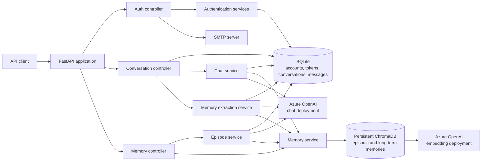
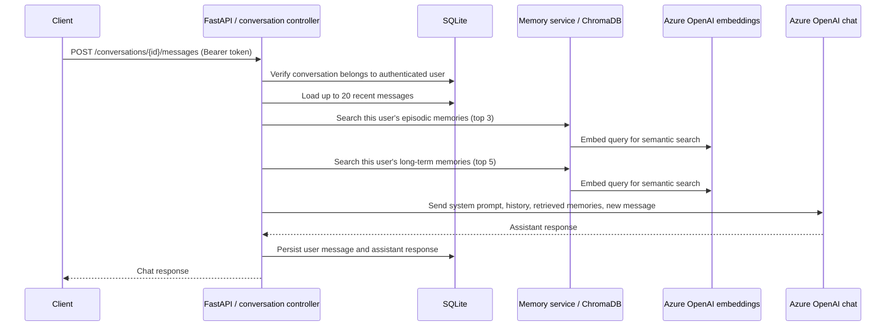
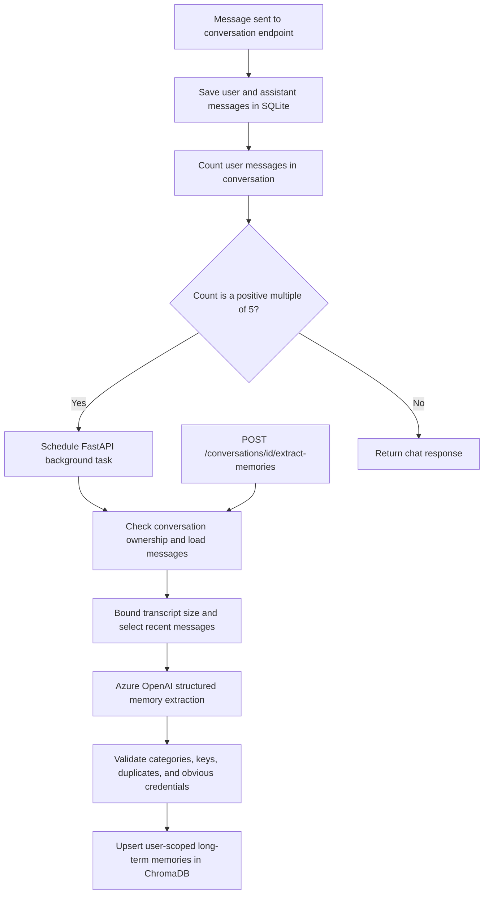
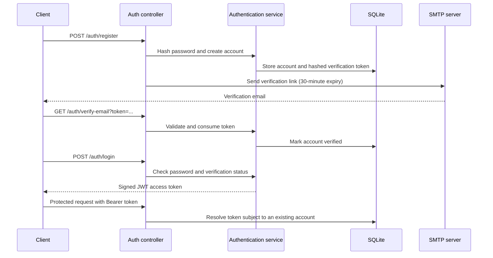

# AI Knowledge Assistant

[](https://www.python.org/)
[](https://fastapi.tiangolo.com/)
[](https://python-poetry.org/)

AI Knowledge Assistant is a Python API for authenticated conversations with an
Azure OpenAI-powered assistant. It persists chat history in SQLite and stores
searchable long-term and episodic memories in ChromaDB. During a conversation,
the assistant can use recent messages and relevant memories as context.

> **Project status:** This README describes the code currently in this
> repository. In particular, `/health` is not currently registered with the
> FastAPI application, and the repository does not contain an automated test
> suite. See [Known limitations](#known-limitations-and-attention-items).

## Table of contents

- [Features](#features)
- [Architecture](#architecture)
- [Memory model](#memory-model)
- [Project structure](#project-structure)
- [Technology stack](#technology-stack)
- [Prerequisites](#prerequisites)
- [Local setup](#local-setup)
- [Azure OpenAI setup](#azure-openai-setup)
- [Configuration reference](#configuration-reference)
- [Storage](#storage)
- [API reference](#api-reference)
- [Security notes](#security-notes)
- [Troubleshooting](#troubleshooting)
- [Development and contribution](#development-and-contribution)

## Features

- **Accounts and authentication:** registration, password hashing, email
  verification, resend-verification, and JWT bearer authentication.
- **Conversation history:** create and list conversations, retrieve messages,
  and persist user/assistant exchanges in SQLite.
- **Recent conversational context:** the latest 20 stored messages are included
  when preparing a chat request.
- **Long-term memory:** create, list, semantically retrieve, update, and delete
  user-scoped facts, preferences, goals, decisions, and corrections.
- **Episodic memory:** summarize a conversation, persist the summary, list
  episodes, and retrieve relevant episodes for later chats.
- **Memory extraction:** extract durable user memories from a conversation
  using Azure OpenAI structured output. Extraction can be requested directly
  or scheduled as a FastAPI background task after each fifth user message.
- **Semantic search:** Azure OpenAI embeddings and ChromaDB similarity search
  are used to retrieve relevant episodic and long-term memories.
- **REST API validation:** FastAPI endpoints use Pydantic request and response
  models. Interactive API documentation is available at `/docs`.

These features are implemented in the source, but depend on working Azure
OpenAI, SMTP, and storage configuration where those integrations are used.
There are no automated tests in the repository to certify end-to-end behavior.

## Architecture

### High-level system



### Chat request and response



The source adds retrieved episodes and long-term memories to the system prompt
as contextual data. Memory records are explicitly framed as historical
information, not instructions. The new user message is added after the stored
history, and the exchange is saved after the model responds.

### Memory extraction and persistence



The background task uses FastAPI's in-process `BackgroundTasks`; it is not a
distributed worker or durable queue. Extraction is also available through the
authenticated manual endpoint. Candidate extraction is bounded to at most 30
recent messages, 3,000 characters per message, 20,000 transcript characters,
and 10 candidates.

### Authentication and email verification



## Memory model

| Memory type | What it means here | Persistence | How chat uses it |
|---|---|---|---|
| Short-term conversational context | Recent messages from the current conversation | SQLite `messages` table | The latest 20 stored messages are reconstructed into the current prompt. Older messages are not included in this context window. |
| Episodic memory | A generated summary of a significant conversation | ChromaDB, tagged as `episodic` | The top 3 semantically relevant episodes for the authenticated user are added to the prompt. Episodes are created through `POST /conversations/{conversation_id}/episode`; they are not automatically summarized by the message handler. |
| Long-term memory | Durable facts, preferences, goals, decisions, and corrections | ChromaDB, tagged as `long_term` | The top 5 semantically relevant memories for the authenticated user are added to the prompt. Memories can be created manually or by extraction. |

SQLite and ChromaDB serve different roles: SQLite stores relational account,
verification, conversation, and message records; ChromaDB stores vector-searchable
memory documents and their metadata. A memory's user ID and memory type are
included in ChromaDB search filters. Semantic search uses cosine-space
configuration, but the code does not apply a relevance-score cutoff.

## Project structure

```text
ai-knowledge-assistant/
├── .env.example                 # Placeholder-only local configuration template
├── .example.env                 # Existing legacy template, retained unchanged
├── .flake8                      # Flake8 settings
├── .gitignore                   # Ignores local secrets, databases, and caches
├── README.md
├── app/
│   ├── __init__.py
│   ├── main.py                  # FastAPI app, startup lifecycle, router registration
│   ├── config.py                # .env loading, Azure chat and JWT configuration
│   ├── database.py              # SQLite schema, conversations, messages, initialization
│   ├── security.py               # Bearer-token authentication dependency
│   ├── controllers/
│   │   ├── __init__.py
│   │   ├── auth_controller.py    # Registration, verification, login, current user
│   │   ├── conversation_controller.py
│   │   └── memory_controller.py  # Episode and long-term memory endpoints
│   ├── schemas/
│   │   ├── auth_schemas.py       # Authentication request/response validation
│   │   ├── chat_schemas.py       # Legacy/session-based chat schema; not used by current routes
│   │   ├── conversation_schemas.py
│   │   ├── episode_schemas.py
│   │   ├── memory_extraction_schemas.py
│   │   └── memory_schemas.py
│   └── services/
│       ├── __init__.py
│       ├── auth_service.py       # Passwords, verification tokens, JWTs
│       ├── chat_service.py       # Prompt construction, context retrieval, Azure chat call
│       ├── email_service.py     # SMTP verification email delivery
│       ├── embedding_service.py # Azure OpenAI embeddings configuration
│       ├── episode_service.py   # Conversation summarization into episodic memory
│       ├── memory_extraction_service.py
│       ├── memory_service.py    # Long-term and episodic memory operations
│       └── vector_store_service.py # Persistent ChromaDB access and semantic search
├── code-quality.py              # Import sorting, formatting, lint, syntax checks
├── data/                        # Runtime-created SQLite and ChromaDB storage (ignored)
├── poetry.lock                  # Resolved dependency versions
└── pyproject.toml               # Python and dependency constraints
```

`data/` is created as needed and is ignored by Git. `.vscode/` and macOS
`.DS_Store` files may exist locally but are ignored and are not application
source.

## Technology stack

Declared constraints are from `pyproject.toml`; Poetry resolves concrete
versions in `poetry.lock`.

| Technology | Declared constraint | Purpose |
|---|---:|---|
| Python | `>=3.14,<4.0.0` | Application runtime |
| FastAPI | `>=0.143.3,<0.144.0` | HTTP API, dependency injection, OpenAPI |
| LangChain | `>=1.4.6,<2.0.0` | Message composition and model integrations |
| `langchain-openai` | `>=1.7.2,<2.0.0` | Azure OpenAI chat and embeddings clients |
| `langchain-chroma` | `>=1.1.0,<2.0.0` | LangChain integration for persistent Chroma |
| ChromaDB | `>=1.5.9,<2.0.0` | Persistent vector store and similarity search |
| Pydantic / `pydantic[email]` | `>=2.14.1,<3.0.0` | Request/response validation and email validation |
| `python-dotenv` | `>=1.2.4,<2.0.0` | Load local `.env` configuration |
| `pwdlib[argon2]` | `>=0.3.1,<0.4.0` | Password hashing |
| PyJWT | `>=2.15.1,<3.0.0` | JWT creation and verification |
| `email-validator` | `>=2.3.0,<3.0.0` | Validation for Pydantic email fields |
| Uvicorn | `>=0.54.0,<0.55.0` | ASGI development/server process |
| poetry-core | `>=2.0.0,<3.0.0` | Build backend declared in `pyproject.toml` |
| SQLite | Python standard library | Relational account, verification, and conversation data |
| SMTP / `smtplib` | Python standard library | Email verification delivery |
| Black | `>=25.1.0,<27.0.0` (development) | Formatting |
| Flake8 | `>=7.1.2,<8.0.0` (development) | Linting |
| isort | `>=6.0.1,<7.0.0` (development) | Import sorting |

## Prerequisites

- Python **3.14 or newer within the `<4.0.0` project constraint**. Install
  Python from [python.org](https://www.python.org/downloads/) or your operating
  system's package manager.
- Poetry 2.x (the project uses Poetry's dependency groups and the
  `package-mode` setting).
- An Azure OpenAI resource with a chat deployment and an embeddings deployment
  for chat and semantic memory features.
- SMTP credentials for registration and verification email delivery.

Confirm the tools are available:

```bash
python3.14 --version
poetry --version
```

If Poetry is not installed, use the
[official Poetry installer](https://python-poetry.org/docs/#installation). On
macOS or Linux, its documented installer command is:

```bash
curl -sSL https://install.python-poetry.org | python3 -
```

## Local setup

### 1. Clone the repository

```bash
git clone https://github.com/ritikdhote02/ai-knowledge-assistant.git
cd ai-knowledge-assistant
```

### 2. Select Python and install dependencies

```bash
poetry env use 3.14
poetry install --with dev
```

`poetry install` installs the application dependencies from `pyproject.toml`
and `poetry.lock`; `--with dev` also installs formatting and lint tools.

### 3. Configure environment variables

```bash
cp .env.example .env
```

Edit `.env` and provide valid Azure OpenAI and SMTP credentials. Keep `.env`
private; it is excluded by `.gitignore`.

### 4. Initialize storage

No manual storage command is required for a normal server start:

- FastAPI's startup lifecycle calls `init_db()` to create the SQLite schema.
- The SQLite parent directory (`data/`) is created by the database connection
  helper.
- ChromaDB's persistence directory is created automatically when the vector
  store is first opened.

To initialize SQLite explicitly before starting the server, the database module
supports:

```bash
poetry run python -m app.database
```

This command initializes SQLite only. ChromaDB initialization remains lazy and
requires valid embedding configuration when the vector store is first used.

### 5. Start the API

```bash
poetry run uvicorn app.main:app --reload
```

Open Swagger UI at <http://127.0.0.1:8000/docs>. The generated OpenAPI document
is at <http://127.0.0.1:8000/openapi.json>.

The repository currently does **not** mount a health router, so
`GET http://127.0.0.1:8000/health` returns `404` even though a health handler
is declared in `app/main.py`. See
[Known limitations](#known-limitations-and-attention-items).

## Azure OpenAI setup

1. Create or select an Azure OpenAI resource in Azure.
2. In Azure AI Foundry / Azure OpenAI, deploy one model for chat completions
   and one model that supports embeddings.
3. Copy the resource endpoint and API key from the resource's deployment or
   key-management page.
4. Set the API version supported by your Azure resource and the Azure OpenAI
   integration version in this environment.
5. Set `AZURE_OPENAI_DEPLOYMENT_NAME` and
   `AZURE_OPENAI_EMBEDDING_DEPLOYMENT_NAME` to the **deployment names** you
   created. These are deployment identifiers, not necessarily the underlying
   model names.

The chat deployment is used by the chat, episode summarization, and structured
memory-extraction code. The embedding deployment is used by ChromaDB to embed
queries and stored memories. Both integrations use the same endpoint, API key,
and API version variables.

## Configuration reference

Copy `.env.example` to `.env`. The project calls `load_dotenv()` from its
configuration and model/vector-store modules. `.env` is not checked in.

| Variable | Required? | Default / behavior |
|---|---|---|
| `AZURE_OPENAI_API_KEY` | Yes for Azure calls | Azure resource API key |
| `AZURE_OPENAI_ENDPOINT` | Yes for Azure calls | Azure resource endpoint URL |
| `AZURE_OPENAI_API_VERSION` | Yes for Azure calls | Azure OpenAI API version |
| `AZURE_OPENAI_DEPLOYMENT_NAME` | Yes for chat, summarization, extraction | Azure chat deployment name |
| `AZURE_OPENAI_EMBEDDING_DEPLOYMENT_NAME` | Yes for vector search/storage | Azure embedding deployment name |
| `JWT_SECRET_KEY` | Yes for token operations | Must be at least 32 characters; no default |
| `JWT_ALGORITHM` | No | `HS256` |
| `ACCESS_TOKEN_EXPIRE_MINUTES` | No | `15` |
| `APP_BASE_URL` | No | `http://127.0.0.1:8000`; trailing slash is removed |
| `SMTP_HOST` | No | `smtp.gmail.com` |
| `SMTP_PORT` | No | `587` |
| `SMTP_USERNAME` | Required for email delivery | No default |
| `SMTP_PASSWORD` | Required for email delivery | No default |
| `SMTP_FROM_EMAIL` | Required for email delivery | Defaults to `SMTP_USERNAME` if unset |
| `SMTP_USE_TLS` | Present in the template, but not read by the current code | SMTP code always calls `starttls()` |
| `CHROMA_PERSIST_DIRECTORY` | No | `data/chroma_db`; relative paths resolve from the project root |
| `CHROMA_COLLECTION_NAME` | No | `assistant_memories` |

Azure values are checked when their model clients are created. Authentication
settings are validated when JWT operations need them. Email delivery fails
explicitly if the SMTP username, password, or sender address is unavailable.
The SMTP service always negotiates STARTTLS regardless of `SMTP_USE_TLS`.

## Storage

| Data | Location | Created when |
|---|---|---|
| Users, verification tokens, conversations, and chat messages | `data/chat_history.sqlite3` | The SQLite connection helper creates `data/`; tables are initialized at application startup. |
| Long-term and episodic memories, embeddings, and vector metadata | `data/chroma_db/` by default | The vector store creates its persistence path the first time it is opened. |

The SQLite path is currently a fixed relative path in `app/database.py`.
ChromaDB's persistence path and collection name can be changed with the
environment variables above. Both storage locations are ignored by Git so
local user data is not accidentally committed.

## API reference

All endpoints are served from the FastAPI application. Request and response
schemas are available in Swagger UI at `/docs`.

Protected endpoints require:

```http
Authorization: Bearer <access_token>
```

### Authentication

| Method | Path | Authentication | Description |
|---|---|---|---|
| `POST` | `/auth/register` | Public | Create an account and send a verification email. |
| `GET` | `/auth/verify-email?token=...` | Public | Verify an email address using the emailed token. |
| `POST` | `/auth/resend-verification` | Public | Resend verification to an unverified account; response does not reveal account existence. |
| `POST` | `/auth/login` | Public | Authenticate a verified account and return a JWT. |
| `GET` | `/auth/me` | Bearer token | Return the authenticated user's profile. |

Registration example:

```json
{
  "name": "Ada Lovelace",
  "email": "ada@example.com",
  "password": "a-long-password-12"
}
```

Login and resend-verification requests use an `email` field; login also
requires `password`. The registration password must be 12–128 characters.

### Conversations and chat

| Method | Path | Authentication | Description |
|---|---|---|---|
| `POST` | `/conversations` | Bearer token | Create a conversation for the current user. |
| `GET` | `/conversations` | Bearer token | List the current user's conversations. |
| `GET` | `/conversations/{conversation_id}/messages` | Bearer token | Retrieve messages after verifying conversation ownership. |
| `POST` | `/conversations/{conversation_id}/messages` | Bearer token | Send a message, retrieve context, call Azure OpenAI, and persist the exchange. |
| `POST` | `/conversations/{conversation_id}/extract-memories` | Bearer token | Extract and persist long-term memory candidates immediately. |

Send-message example:

```json
{
  "message": "What database did I say I prefer?"
}
```

The message must contain 1–10,000 characters. Memory extraction returns the
number of candidates found and saved memories.

### Episodic memory

| Method | Path | Authentication | Description |
|---|---|---|---|
| `POST` | `/conversations/{conversation_id}/episode` | Bearer token | Summarize an owned conversation and create or refresh its episode. At least two messages are required. |
| `GET` | `/episodes` | Bearer token | List the current user's episodic memories. |

Episode generation uses up to the latest 60 messages and truncates each message
to 1,500 characters before sending the transcript to the chat deployment.

### Long-term memory

| Method | Path | Authentication | Description |
|---|---|---|---|
| `POST` | `/memories` | Bearer token | Create a long-term memory. |
| `GET` | `/memories` | Bearer token | List the current user's long-term memories. |
| `PATCH` | `/memories/{memory_id}` | Bearer token | Update a memory value and category. |
| `DELETE` | `/memories/{memory_id}` | Bearer token | Delete a memory belonging to the current user. |

Create-memory example:

```json
{
  "memory_key": "preferred_database",
  "memory_value": "The user prefers SQLite for personal projects.",
  "category": "preference",
  "source_conversation_id": null
}
```

Allowed categories are `fact`, `preference`, `goal`, `decision`, and
`correction`. Memory keys are normalized to lowercase and must contain only
letters, numbers, and underscores. `source_conversation_id` is optional; when
provided, it must identify a conversation owned by the user.

### Health endpoint status

There is currently no registered health endpoint. Although `app/main.py`
defines a local `APIRouter` with `GET /health`, that router is not included in
the FastAPI app. It therefore does not appear in OpenAPI and requests to
`/health` return `404`.

## Security notes

- Keep Azure keys, SMTP credentials, and `JWT_SECRET_KEY` in local environment
  configuration. `.env` is ignored by Git; never commit populated credentials.
- The supplied `.env.example` contains placeholders only. Rotate any real
  credential that has been committed or exposed.
- `JWT_SECRET_KEY` must contain at least 32 characters. Use a strong,
  randomly-generated secret outside local development.
- Passwords are hashed with `pwdlib`; plaintext passwords are not stored.
- Email verification tokens are stored as hashes and expire after 30 minutes.
- Protected routes resolve the JWT subject to a current account. Conversation
  ownership is checked before accessing conversations; memory operations and
  semantic searches are scoped to the authenticated user.
- Memory extraction has application checks for allowed categories, duplicate
  keys, transcript limits, and obvious credential-like values. These checks
  do not replace careful handling of sensitive data.
- Email is delivered through configured SMTP credentials over STARTTLS.

## Troubleshooting

| Symptom | Checks |
|---|---|
| Poetry reports an unsupported Python version | Confirm Python 3.14 is installed and selected with `poetry env use 3.14`. The project currently requires `>=3.14,<4.0.0`. |
| Missing Azure chat configuration | Set `AZURE_OPENAI_API_KEY`, `AZURE_OPENAI_ENDPOINT`, `AZURE_OPENAI_API_VERSION`, and `AZURE_OPENAI_DEPLOYMENT_NAME`. Confirm the deployment exists and the name is exact. |
| Missing embedding configuration or vector-store errors | Set `AZURE_OPENAI_EMBEDDING_DEPLOYMENT_NAME` along with the shared endpoint, API key, and API version. Confirm the Azure deployment supports embeddings and that the Chroma path is writable. |
| Chat, embedding, or extraction requests fail after configuration | Verify the resource endpoint, API key, API version, deployment names, Azure availability, and model permissions. Check the server log for the underlying integration error. |
| SQLite cannot be opened | Start the application from the repository root. The fixed relative database path is `data/chat_history.sqlite3`; ensure its parent directory is writable. |
| ChromaDB cannot create/open its store | Check that `CHROMA_PERSIST_DIRECTORY` is writable. Relative paths resolve from the project root and the application attempts to create the directory automatically. |
| Registration returns an email delivery error | Set `SMTP_USERNAME`, `SMTP_PASSWORD`, and `SMTP_FROM_EMAIL` (or let the sender default to the username). Confirm SMTP host/port and provider app-password requirements. The code always uses STARTTLS. |
| A registration succeeded but the email was not sent | The account is created before email delivery is attempted. Configure SMTP and use `/auth/resend-verification` to request another verification email. |
| `GET /health` returns `404` | This is the current application wiring: the handler's router is not mounted. Use `/docs` to confirm the API process is running, and see [Known limitations](#known-limitations-and-attention-items). |
| `/docs` is unreachable | Confirm Uvicorn started successfully and that the requested host/port match the server command. |

## Development and contribution

Install development dependencies and run the repository's quality script:

```bash
poetry install --with dev
poetry run python code-quality.py
```

`code-quality.py` sorts imports, formats Python files, removes trailing
whitespace, runs Flake8, and checks Python syntax. It may modify Python files
when formatting or cleaning whitespace.

There are currently no test files or configured test command in the repository.
For changes, include focused tests when adding test coverage, run the quality
script, and verify relevant API behavior through `/docs` or a local client.
Keep credentials and generated `data/` contents out of commits.

Suggested contribution workflow:

1. Create a focused branch for the change.
2. Keep changes scoped and add or update tests where applicable.
3. Run `poetry run python code-quality.py`.
4. Open a pull request describing the change and its validation.
